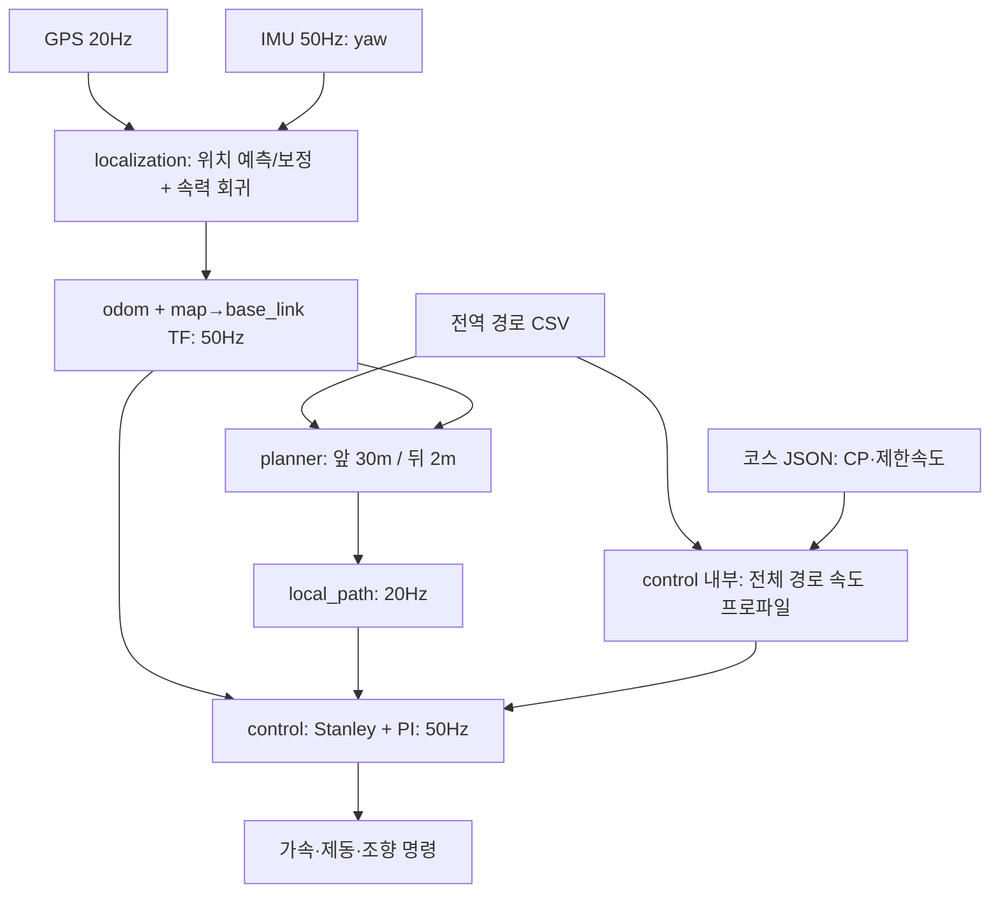

# MORAI 6장 대응 구현

## 실행
운영진 ROS 2 Humble 팀 셸에서 `hk_interfaces`가 제공되어야 합니다.

```bash
colcon build
source install/setup.bash
ros2 launch hk_morai bringup.launch.py target_speed:=8.0 rviz:=true
```

START 이벤트 이후 출발합니다. `use_sim_time=false`를 유지합니다.

## 구현
- GPS 위치 예측/보정 및 기본 0.3초 샘플 회귀를 통한 속력 추정, GPS 사이 위치 외삽.
- 전체 전역 경로의 3점 곡률 기반 속도 상한, 코스 JSON의 제한속도 적용, 역방향 감속거리 계산.
- 기본 목표 8m/s (28.8km/h), 커브 허용 횡가속도 1.8m/s². 완주 시간은 실제 주행으로 검증해야 합니다.
- CP4→5는 30km/h에서 0.5m/s 여유를 빼고 전후 5m 확장. CP10→12는 법정 제한만 해제하며 목표속도/곡률 상한은 유지.
- 출발 목표속도 증가율 제한, 조향 변화율 제한, 제동 중 적분 초기화.
- 목표 초과속력 0.3m/s에서 제동 시작, 0.1m/s 이하에서 해제. 작은 초과는 구동 없이 타력 주행.
- 입력 단절 뒤 복구 시 현재 속력에서 목표속도 램프 재개. 실행 목표와 제동 사유를 로그로 발행.
- 센서 단절 시 localization 발행 중단, control의 odom/path 타임아웃 0.5초 후 제동. 빈 경로는 전제동.
- START/RESPAWN에서 필터·제어 상태 초기화, END에서 제동.

`config/bringup.yaml`에서 필터 계수, 감속 가정, 속도 여유, 조향 변화율 등을 조정합니다.
GPS 큰 점프 거부 임계치는 현재 10m입니다. 필터와 감속 가정은 실차 모델 및 노이즈별 현장 튜닝이 필요합니다.
LiDAR/카메라는 기존 수신 노드이며 장애물 회피·신호등 인식은 추가 구현 대상입니다.

## 참고 ZIP
`/home/juna/Desktop/heven-ad-2026-dev.zip`의
`ad_control/include/ad_control/path/route_speed_profile.hpp`,
`ad_control/src/lateral/stanley.cpp`, `ad_planner/config/planner.yaml`을 검토했습니다.
곡률 속도 제한, 감속 프로파일, 출발 램프 및 조향 변화율 제한 방식을 참고해 Python으로 작성했습니다.
참고 ZIP의 /ad 토픽, CP14→15 음영구역, 최대 조향각 40도 설정은 이번 대회에 적용하지 않았습니다.
해커톤 제어 계약의 최대 조향각 35.4도와 /hk 토픽을 사용합니다.

## 검증
`PYTEST_DISABLE_PLUGIN_AUTOLOAD=1 python3 -m pytest -q src/hk_morai/test`

20개 테스트: 보호구역 진입 전 감속, 원형 곡률, 실제 코스 유한값/감속 조건,
잘못된 파라미터, 빈 경로/오래된 입력/END 제동, 제동 히스테리시스, 입력 복구,
출발 램프/커브 감속, GPS 가속 추정 지연, 직선 폐루프 추종(3·8m/s, 단절 유무).
폐루프 테스트의 차량은 간단한 가감속·저항 모델이며 MORAI 차량 물리를 재현하지 않습니다.
제어 테스트는 ROS 없이 실제 메서드 본문을 실행하며 메시지 통합 테스트가 아닙니다.
colcon 패키지 빌드 통과. MORAI 운영진 PC에서의 실제 주행과 ROS 통합은 미검증입니다.

## 파라미터 변경과 적용 방법

설정 파일은 `config/bringup.yaml`입니다. 아래 표의 값은 현재 소스 기준입니다.
최초 변경에서 `target_speed: 3.0 → 8.0`으로 높였고, 반복 제동 수정에서는
`speed_alpha: 0.25 → 0.5`, `speed_window: 기존 고정 0.5초 → 파라미터 0.3초`로 추정 지연을 줄였습니다.
기존 `k_stanley`, `k_soft`, `kp`, `ki`, `brake_gain`, `ahead_m`, `behind_m`은 유지했고,
필터·속도 계획·입력 유효성 관련 파라미터를 추가했습니다.

- 노드가 시작할 때 파라미터를 읽어 내부 변수에 복사합니다. 현재 `ros2 param set`으로 값을 바꿔도 제어 계산에 반영되지 않습니다. 설정 변경 후 팀 노드를 다시 실행해야 합니다.
- 일반 `colcon build`는 YAML을 install 폴더에 복사합니다. 소스 YAML 변경 후 다시 빌드하고 `source install/setup.bash`를 실행해야 합니다.
- `target_speed`는 launch 인자(기본 8.0)가 YAML 값을 덮어씁니다. 속도를 변경할 때는 `target_speed:=6.0`처럼 명시하세요.
- `route_csv`, `course_json`도 launch 인자를 통해 각 노드에 전달됩니다. 빈 문자열이면 설치된 패키지의 기본 코스 파일을 사용합니다.
- `lateral_accel:=...` 등은 현재 launch 인자로 선언되어 있지 않습니다. 이 값은 YAML에서 변경합니다.
- 현재 숫자는 최적화된 실측값이 아니라 현장 검증을 시작하기 위한 설정입니다.

```bash
colcon build
source install/setup.bash
ros2 launch hk_morai bringup.launch.py target_speed:=6.0 rviz:=true
```

### 위치 추정 노드: hk_morai_localization

| 파라미터 | 현재값 | 의미 | 높일 때 | 낮출 때 |
| --- | --- | --- | --- | --- |
| `position_alpha` | 0.35 | 예측 위치를 GPS 관측 쪽으로 보정하는 비율, 0 < 값 ≤ 1 | GPS를 빨리 따라가지만 노이즈가 더 반영됨 | 부드럽지만 예측 오차가 오래 남음 |
| `speed_alpha` | 0.5 | 회귀로 구한 속력을 기존 속력에 반영하는 비율, 0 < 값 ≤ 1 | 가감속 반응이 빠르지만 추정 속력이 흔들림 | 속력이 부드럽지만 실제 가감속을 늦게 따라감 |
| `speed_window` | 0.3s | 속력 회귀에 쓰는 GPS 시간 폭, 0.25초 이상 | 노이즈 완화가 커지지만 추정 지연 증가 | 가감속 반응이 빨라지지만 노이즈 민감도 증가 |
| `sensor_timeout` | 0.5s | 마지막 GPS와 IMU 각각의 최대 허용 나이 | 단절에도 odom을 더 오래 예측 발행함 | 지연에 민감하게 발행을 중단함 |

`course_json`은 원점·출발점·복귀 체크포인트를 읽는 경로입니다.
IMU yaw에는 추가 저역통과 필터를 적용하지 않았습니다. 위치·속도 필터를 추가했다고 IMU 노이즈까지 제거되는 것은 아닙니다.
현재 속력 필터는 사용자가 보고한 노이즈 없는 주행의 지연을 줄이는 방향으로 조정했습니다.
GNSS 노이즈를 켜서 추정 속력이 흔들린다면 `speed_window: 0.5`, `speed_alpha: 0.25`부터 별도로 검증합니다.

### 속도 계획: hk_morai_control

| 파라미터 | 현재값 | 의미와 조정 효과 |
| --- | --- | --- |
| `target_speed` | 8.0m/s | 전체 목표속도 상한. 28.8km/h. 높여도 곡률/법정속도 상한은 유지. 양수여야 함 |
| `lateral_accel` | 1.8m/s² | 곡선 허용 횡가속도. 높이면 커브 목표속도가 증가, 낮추면 감소. 양수여야 함 |
| `planning_decel` | 1.5m/s² | 사전 감속거리 계산에서 가정한 감속도. 낮추면 더 일찍 감속, 높이면 더 늦게 감속. 실제 브레이크 명령의 세기가 아님. 양수여야 함 |
| `speed_margin` | 0.5m/s | 법정 제한속도에서 빼는 여유. 높이면 제한구간 목표속도가 낮아짐. 0 이상 |
| `zone_buffer` | 5.0m | 보호구역 앞뒤로 확장하는 거리. 높이면 더 일찍 제한하고 더 늦게 해제. 제한 없는 구간은 반대로 앞뒤를 축소. 0 이상 |
| `launch_accel` | 1.0m/s² | 목표속도가 올라가는 최대 변화율. 높이면 출발과 커브 후 속도 회복이 빠름. 실제 차량 가속도와 다름. 양수여야 함 |

`target_speed=8.0`에서 일반 도로 상한은 8.0m/s이고, 보호구역은
`min(8.0, 30/3.6 - 0.5) = 7.833...m/s`, 즉 약 28.2km/h입니다.
CP10→12에서도 설정 목표속도 8.0m/s와 곡률 상한은 남습니다.

### 조향·속도 추종: hk_morai_control

| 파라미터 | 현재값 | 의미와 조정 효과 |
| --- | --- | --- |
| `k_stanley` | 1.0 | 경로 옆 오차에 대한 조향 세기. 높이면 복귀가 적극적이나 좌우 진동 가능. 낮추면 복귀가 느려짐 |
| `k_soft` | 1.0m/s | Stanley 분모의 저속 완화값. 높이면 옆 오차 보정이 약해짐. 방향 오차 항은 그대로. 양수여야 함 |
| `steer_rate` | 1.0rad/s | 앞바퀴 목표 조향각의 변화율 제한. 약 57.3도/s. 높이면 조향 반응이 빨라지고 낮추면 부드러워지지만 급커브에서 늦을 수 있음 |
| `kp` | 0.5 | 속도 오차에 비례하는 명령 크기. 높이면 가속/감속 반응이 커지지만 진동·오버슈트 가능 |
| `ki` | 0.05 | 누적 속도 오차 보정. 높이면 지속적인 저속 오차 보정이 강해지지만 오버슈트 가능 |
| `brake_gain` | 0.6 | 제동 상태에서 `brake_kp × (초과속력 - brake_off_error)`에 곱하는 배율. 높이면 같은 속도 오차에서 제동 명령 증가 |
| `brake_on_error` | 0.3m/s | 목표 초과속력이 이 값을 넘으면 제동 시작. 높이면 작은 오차에 덜 민감해지지만 과속 여유 감소 |
| `brake_off_error` | 0.1m/s | 제동 중 초과속력이 이 값 이하가 되면 해제. 0 이상, 시작 기준보다 작아야 함 |
| `input_timeout` | 0.5s | odom과 path 각각의 최대 허용 메시지 나이. 넘으면 전제동하고 제어 상태 초기화. 양수여야 함 |

`kp`, `ki`, `brake_gain`, `k_stanley`는 음수가 되지 않게 조정하세요.
센서 단절 후 제동까지는 `sensor_timeout`과 `input_timeout`이 연달아 작용할 수 있습니다.
기본 설정에서 약 0.5초까지 odom을 발행한 뒤, 그 마지막 odom도 0.5초 오래되면 제동하므로 총 약 1초와 스케줄링 지연이 걸릴 수 있습니다.

### 경로 노드와 launch 설정

| 설정 | 현재값 | 의미 |
| --- | --- | --- |
| `ahead_m` | 30m | 전역 경로에서 앞쪽으로 잘라 발행할 길이. 늘려도 Stanley가 그 끝점을 직접 바라보는 것은 아님 |
| `behind_m` | 2m | 뒤쪽으로 남길 길이 |
| `route_csv` | 빈 문자열 | 빈 값이면 기본 CSV. 현재 planner는 점 간격 0.5m를 가정하므로 다른 CSV도 이 간격에 맞춰야 함 |
| `course_json` | 빈 문자열 | 빈 값이면 기본 JSON. 경로와 동일한 좌표계/코스여야 함 |
| `use_sim_time` | false | MORAI는 /clock이 없으므로 false 유지 |
| `rviz` | false | RViz 실행 여부 |
| `perception` | false | LiDAR·카메라 수신 노드 실행 여부. true만으로 회피·신호 인식이 생기지는 않음 |
| `sensor_tf` | true | sensor_mounts.yaml 기반 정적 센서 TF 발행 여부 |

## 설계와 계산 순서



### 위치 추정

GPS 위경도를 UTM 52N 좌표에서 지도 원점을 뺀 map 좌표로 변환합니다.
새 GPS가 도착하면 마지막 위치에서 속력과 현재 yaw로 이동을 예측합니다.

```text
예측 x = 이전 x + 속력 × cos(yaw) × dt
예측 y = 이전 y + 속력 × sin(yaw) × dt
보정 위치 = 예측 위치 + position_alpha × (GPS 위치 - 예측 위치)
```

예측 x가 10m이고 GPS x가 11m이면 alpha 0.35일 때 보정 결과는 10.35m입니다.
첫 GPS 또는 timeout 이후 GPS는 예측 보정 없이 직접 위치를 채택하고 속력 이력을 초기화합니다.
정상 연속 수신 중 예측과 10m 넘게 다른 GPS는 거부합니다. 지속적인 GPS 오차를 해결하는 필터는 아니며,
timeout 이후 재수신 시에는 다시 직접 채택한다는 한계가 있습니다.

속력은 최근 `speed_window`초(기본 0.3초)의 GPS 샘플 전체에 직선을 맞추는 최소제곱 회귀로 vx, vy를 구한 뒤,
차량 방향으로 투영하고 음수를 0으로 제한합니다. 샘플 4개 이상, 시간 폭 0.2초 초과일 때 계산합니다.

```text
관측 전진 속력 = max(0, vx × cos(yaw) + vy × sin(yaw))
새 속력 = 이전 속력 + speed_alpha × (관측 전진 속력 - 이전 속력)
```

위치 예측에는 필터 속력을 사용합니다. 50Hz 발행 시 마지막 GPS 이후 이동분을 더해 위치를 외삽합니다.
미래 GPS로 과거를 보정하는 보간이 아니라 현재까지의 짧은 외삽이며, 급가감속 시 오차가 생길 수 있습니다.
공분산 기반 EKF나 SLAM은 아닙니다.

### 전역 경로와 속도 프로파일

planner는 제공된 경로 자체를 바꾸지 않고 주변 구간만 잘라 전달합니다.
경로 위치는 최초에 전체에서 찾고, 이후 이전 인덱스부터 앞 80점(약 40m)에서 찾습니다.
따라서 보통 인덱스는 뒤로 가지 않지만, CP 순서 통과 여부를 판정하는 별도 상태기는 없습니다.

속도 프로파일은 **현재 control 노드에서** START 때 전체 CSV·JSON을 읽어 미리 계산합니다.
전체 경로를 이용하므로 국소 경로 30m 바깥의 감속 필요성도 계산에 반영됩니다.
각 CP를 순서대로 전역 경로에 대응시켜 제한구간의 시작·끝 위치를 찾습니다.

현재점 i와 i-5, i+5의 세 점으로 곡률을 계산합니다. 0.5m 간격이면 약 5m 폭입니다.
곡률 κ의 역수가 회전반경 R이고, 횡가속도 a = v²κ 관계에서 다음 상한을 얻습니다.

```text
곡률 상한 속력 = sqrt(lateral_accel / |κ|)
해당 점 속력 = min(target_speed, 법정속도 - speed_margin, 곡률 상한 속력)
```

반경 10m 곡선이라면 현재 1.8m/s² 기준 속력 상한은 sqrt(18) ≈ 4.24m/s(15.3km/h)입니다.
경로 끝에서는 양쪽 점을 충분히 확보하지 못해 곡률 추정이 약해질 수 있습니다.

이후 경로 끝에서 시작 방향으로 역순으로 돌며 감속 조건을 적용합니다.

```text
v[i] = min(v[i], sqrt(v[i+1]² + 2 × planning_decel × 점 사이 거리))
```

10m/s에서 5m/s까지 1.5m/s²로 줄이려면 (100-25)/(2×1.5) = 25m가 필요합니다.
이 계산 때문에 커브 안에 들어간 다음이 아니라 커브 전에 목표속도가 낮아집니다.
브레이크 지연과 실제 노면/차량 응답을 모델링하지 않았으므로 현장 검증이 필요합니다.
도착선은 넘어야 하므로 프로파일 마지막 속도를 강제로 0으로 만들지 않습니다.

### 조향과 PI 속도 제어

Stanley 제어는 뒤차축 위치에서 축간거리 3m만큼 앞의 앞차축 위치를 계산하고,
국소 경로에서 이 앞차축과 가장 가까운 점의 위치·방향을 사용합니다.

```text
조향각 = 방향 오차 + atan2(k_stanley × 옆 오차, k_soft + 현재 속력)
정규화 조향 = 조향각 / 35.4도   → [-1, 1] 제한
```

예를 들어 차 방향이 올바르지만 경로가 왼쪽에 있으면 옆 오차 항이 좌회전 명령을 만듭니다.
계산한 조향각은 직전 조향에서 `steer_rate × 0.02초` 이상 바뀌지 않게 제한합니다.
현재 설정은 매 tick 약 1.15도 이내입니다. 이는 명령 제한이며 실제 휠각 측정 기반 제어는 아닙니다.

속도 프로파일 인덱스는 앞차축이 아니라 뒤차축 위치에서 찾습니다.
처음 유효 입력 또는 입력 단절 후 복구 시 현재 추정 속력(프로파일 상한 이하)에서 램프를 시작합니다.
정지 출발 또는 목표속도 상승 시 `launch_accel × 0.02초`씩 목표속도를 올리고,
감속이 필요할 때는 그 상승 제한을 적용하지 않고 즉시 낮은 목표속도를 채택합니다.

```text
오차 = 목표 속력 - 추정 속력
u = kp × 오차 + ki × 누적 오차
제동 시작: 초과속력 > brake_on_error
제동 해제: 초과속력 ≤ brake_off_error
제동 중: accel = 0, brake = min(brake_kp × (초과속력 - brake_off_error) × brake_gain, 1)
그 외: error > 0이면 accel = clamp(u, 0, 1), 아니면 accel = 0; brake = 0
```

제동 중 적분값을 0으로 지웁니다. 양의 출력이 1 이상 포화 중일 때 양의 오차를 더 쌓지 않고,
작은 초과속력에서는 적분을 줄입니다. 적분 누적값은 [0, 5]로 제한합니다.
목표속도가 0.5m/s 부족하고 적분이 0이면 기본 kp 0.5에서 accel 0.25입니다.
0.5m/s 초과하면 제동을 시작하며 brake는 0.5×(0.5−0.1)×0.6 = 0.12입니다.

### 시도 이벤트와 정지

- START: 파일 재로딩, 필터·경로 인덱스·PI 적분·출발 램프·직전 조향 초기화.
- RESPAWN: 해당 CP의 공개 코스 자세로 초기화하고 센서 수신 재개를 기다림.
- 처음 0.5초 또는 odom/path 미수신: 제동. 첫 유효 센서가 도착해야 localization이 발행하므로 실제 출발시간은 수신 상황에 따라 달라짐.
- 오래된 odom/path 또는 빈/비정상 경로: 제동.
- END: 즉시 전제동 명령 1회 발행 후 제어 루프 비활성화.
- 기존 planner의 경로 말단 이탈 판정: 마지막 근처에서 끝점과 5m 넘게 떨어지면 빈 경로를 발행.

### 아직 코드 상수인 값

공식 직전 YAML로 바꿀 수 있는 값과 구별해야 합니다.
GPS 점프 거부 10m, 회귀 최소 시간 0.2초, 관측 속력 상한 50m/s,
곡률 창 ±5점, 축간거리 3m, 최대 조향각 35.4도, 제어/위치 발행 50Hz,
planner 20Hz, 시작 대기 0.5초, 적분 한계 5 등은 현재 코드 상수입니다.
`config/sensor_mounts.yaml`은 센서 정적 TF용이며 차량 축간거리나 제어 최대 조향각을 바꾸지 않습니다.

## 현장 조정 순서

1. 낮은 목표속도로 GPS/IMU 수신, TF, 추정 속력과 위치, CP 부근 추종을 먼저 확인합니다.
2. 좌우 진동이면 `k_stanley`를 조금 낮추거나 `k_soft`를 높이는 방향을 각각 따로 시험합니다. 조향 제한이 너무 느려 커브를 놓치는지도 확인합니다.
3. 커브에서 크게 벗어나면 우선 `lateral_accel`을 낮춰 감속을 늘립니다. `ahead_m`만 늘리는 것은 조향 preview 조정이 아닙니다.
4. 감속 시작이 늦으면 `planning_decel`을 낮추고, 보호구역 위치 오차가 문제면 `zone_buffer`를 늘립니다. 실제 제동 명령이 약할 때는 별도로 `brake_gain`을 확인합니다.
5. GPS 노이즈에 흔들리면 alpha를 낮추는 방향을 시험하되 가감속 시 속력 추정 지연도 함께 확인합니다.
6. 추종이 안정된 뒤 `target_speed`를 단계적으로 올립니다. 한 번에 한 파라미터를 바꾸고 실제 속도·차선·CP 통과·시간을 기록합니다.

속도를 높여서 시간만 줄이는 것보다 차선 침범/과속 패널티를 피하고 완주하는 것이 우선입니다.
노이즈 켬/끔 조합은 운영진 측정기에서 선택하며 위 YAML의 alpha나 timeout과는 별개입니다.

## 추가 참고 코드 반영 (2026-11-13)

사용자가 제공한 `/home/juna/Downloads/heven-ad-2026-dev.zip`의
`ad_control/src/longitudinal/pid.cpp`, 해당 헤더,
`ad_planner/config/planner.yaml`,
`ad_localization/src/gnss_imu/gnss_imu_localizer.cpp`를 직접 비교했습니다.

- 가속/제동 이득 분리: `brake_kp` 기본 0.5를 추가했습니다. `kp`만 튜닝해도 제동이 바뀌던 결합을 제거했습니다. 최종 제동 배율은 `brake_kp × brake_gain`입니다.
- 참고 PID의 deadband 차감을 히스테리시스와 결합했습니다. 제동 중 초과속력에서 해제 기준 0.1m/s를 빼므로 해제 직전 브레이크가 0으로 줄어듭니다. 시작 기준은 0.3m/s입니다.
- 적분 갱신 후보를 적용한 출력이 포화되는지 검사해 적분 누적을 방지합니다.
- 참고 설정의 PID 이득은 제어기 종류에 따라 다르므로 수치를 그대로 복사하지 않았습니다. GNSS 속력 추정에 미분항을 추가하면 잡음 영향이 커질 수 있어 현재 PI를 유지합니다.
- 참고 GNSS/IMU localizer는 동기화된 바퀴 속도가 없으면 twist 속도를 0으로 남깁니다. 이번 공개 센서에는 바퀴 속도가 없으므로 GPS 회귀 추정을 유지합니다.

20개 오프라인 테스트 통과. 실제 MORAI 현장 주행은 아직 검증하지 않았습니다.
사용자는 약 3시간 뒤 현장 디버깅이 가능하다고 했으므로, 지금 런타임 로그를 요구하지 않고 코드 비교와 로컬 검증으로 준비했습니다.
